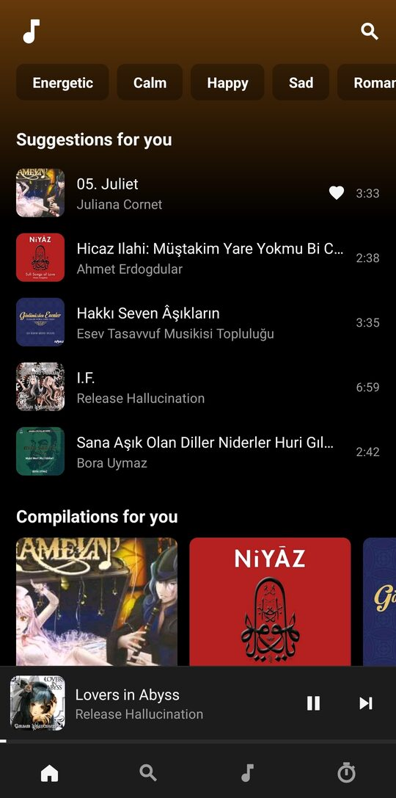
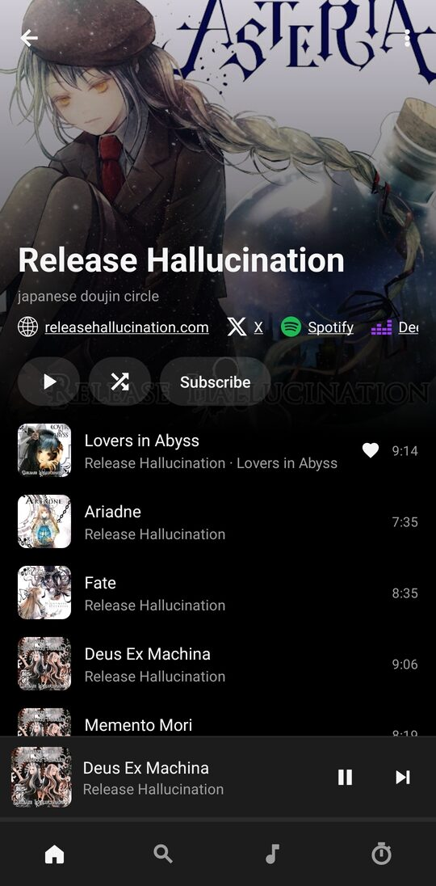
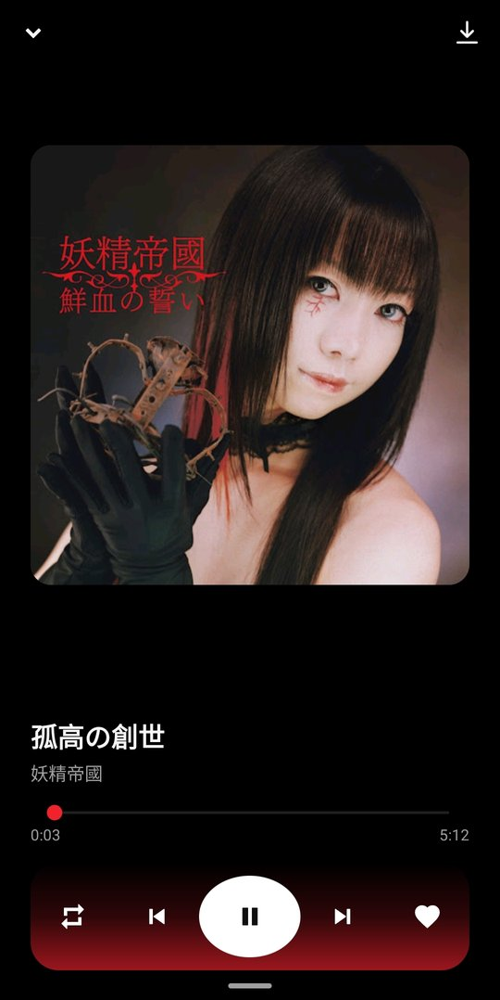
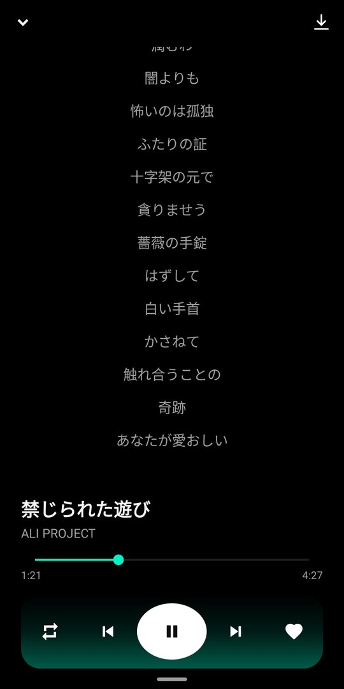

# Nota

[](https://github.com/DavutKaraoglan/nota/releases/latest)
[](AndroidManifest.xml)
[](LICENSE)

Music player for Android. It plays the songs on your phone and can fetch the ones that are not.

<p>
  
  
  
  
</p>

- **Suggestions from your own listening.** Nota counts what you finish and what you skip, and builds the home screen from that, on the phone.
- **Songs that are not on the phone.** Search YouTube in the app and play the result.
- **Lyrics** that scroll with the song.
- **Light on data.** What it fetches once is kept, so screens open again without the network.
- **Small.** The APK is under 300 KB.

Your listening history stays on the phone. Searches, covers and lyrics are fetched from YouTube, MusicBrainz, Wikidata and LRCLIB, which see what you searched for and your IP address.

## Build

On Android with [Termux](https://termux.dev):

```sh
pkg install openjdk-21 aapt2 d8 apksigner zip
cp .../platforms/android-33/android.jar tools/android33.jar
./build.sh
```

The APK lands in `build/nota.apk`, signed with a local debug key.

## Licence

GPL-3.0-or-later, see [LICENSE](LICENSE). Releases up to 1.3.2 were published under MIT.
